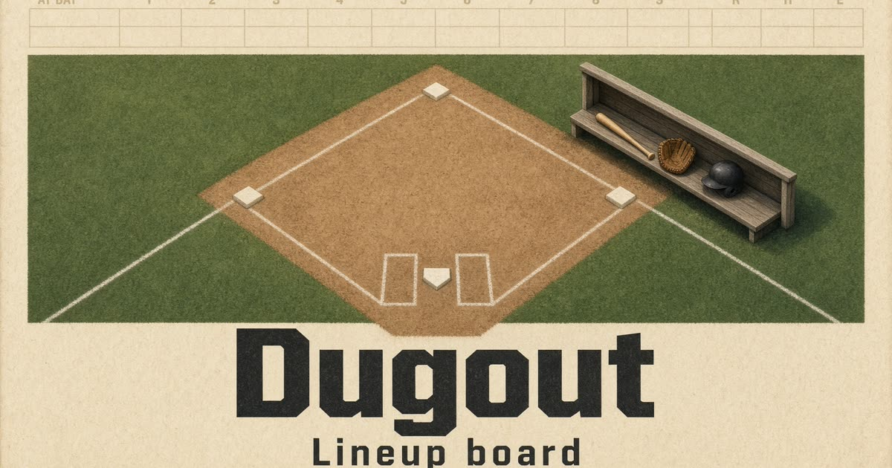

# Dugout

Lineup board for youth baseball and softball. Name the team, pick a code you can remember, and start a game. Every coach who joins with that code sees the same roster, defense, and batting order.



## During a game

- Drag a player onto a position, or tap a player and then a spot. Tap the bench to sit them.
- Play nine, or ten with a rover.
- Fill an empty inning, or rebalance so sits stay even. The board flags anyone who sat back to back.
- Keep the batting order, the at-bat, and who is on deck.
- Move through up to twelve innings. Undo is one tap.
- Start a new game on the same code. The roster and batting order stay, the field clears, and the leadoff hitter comes up.

Anyone with the code can change the game. There are no accounts.

## Run it

Requires Node 22.

```bash
npm install
npm run dev
```

Open http://127.0.0.1:8080.

With no `DATABASE_URL`, games are stored in an embedded Postgres (PGLite) that lives with the server process. Set `DATABASE_URL` to a Postgres connection string and the migrations in `migrations/` run against that database. `npm run build` applies pending migrations when the variable is set.

```bash
npm test
npm run typecheck
```

## Stack

React 19, TanStack Start, Vite, Tailwind CSS, Zustand, and Postgres.
